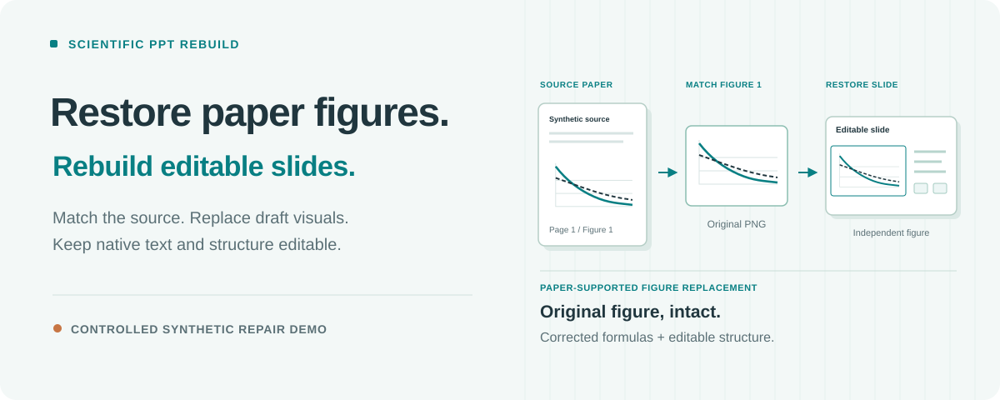
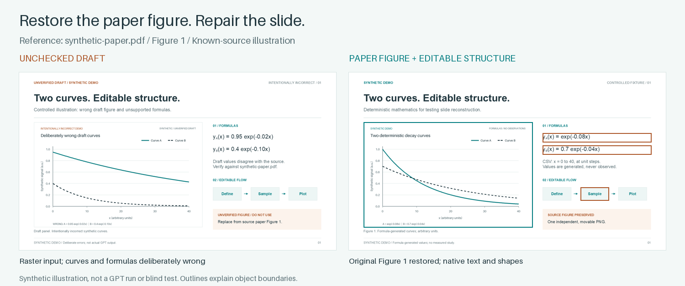
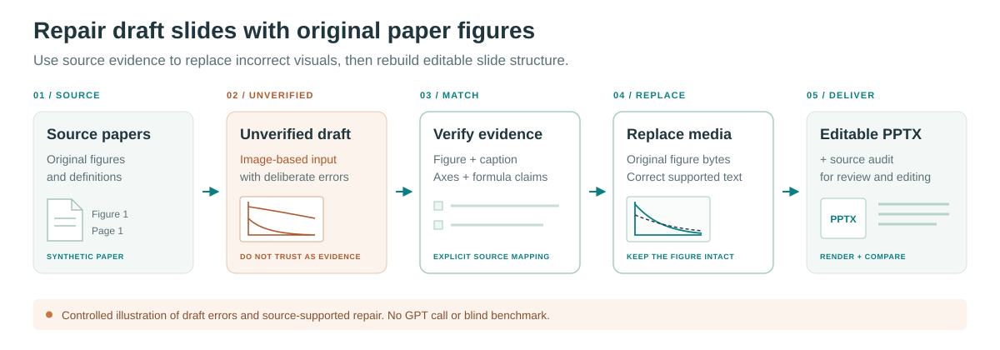

# Scientific PPT Rebuild

**Paper-aware repair for AI-generated scientific slides.**

[简体中文](README.zh-CN.md) · [Usage guide](docs/usage.md) · [Privacy](docs/privacy.md) · [Dependencies](docs/dependencies.md) · [Contributing](CONTRIBUTING.md)



A polished image-based slide can contain a distorted graph, a wrong equation, or a label the paper never supported. Supply the slide draft and its paper DOCX/PDF files. This Codex skill checks the paper-to-slide correspondence, replaces verified figure regions with actual paper media, corrects supported labels and callouts, and rebuilds an editable PowerPoint layout.

```text
Paper → AI/image-based slide draft → paper-aware repair → editable, source-audited deck
```

The skill handles the repair and reconstruction stage. Generic image-to-editable conversion restores editability; this workflow adds verified paper/Figure/panel correspondence, original-media replacement, full-Figure retention, and a trace of sources, corrections, hashes, and crops. Scientific pictures remain unchanged after selection from the verified source.

Version **0.1.0** · Folder-based Codex skill · Final acceptance uses **Windows desktop PowerPoint**

## Install

Ask Codex:

```text
Install the Codex skill from this GitHub directory:
https://github.com/fwbeiliya66/scientific-ppt-rebuild/tree/main/skills/scientific-ppt-rebuild
```

Or download/clone this repository and run from its root with Python 3.11+:

```sh
python install.py --install-deps
```

This installs the skill in the local `.codex/skills` layout and creates a dedicated `.venv` inside the installed skill. Omit `--install-deps` if you already have a suitable Python environment. On Windows, [`Install.ps1`](Install.ps1) detects Python and installs dependencies by default.

Existing installations are protected. If dependency setup fails, the copied core and any previous backup remain, and the installer prints repair commands. See the [installation guide](docs/usage.md#installation) for recovery, custom destinations, and explicit replacement. If Codex does not discover the skill, reopen the app.

## Repair a draft against its paper

Attach the slide draft and the paper files, then ask:

```text
Use $scientific-ppt-rebuild to repair these draft slides against the attached papers.
Check each result's claim, experiment, Figure, caption, panel, axes, and units.
Replace verified corresponding figures with actual paper media. Retain full Figures
and use native picture crops for panels. Correct slide labels, equations, units, and
callouts only where the paper supports the correction, and record each change.
Rebuild the surrounding text and layout as native PowerPoint objects.
Retain unmatched draft regions as unverified and report suspected invented content.
Deliver a new PPTX, source/correction audit, used Figures, and PowerPoint QA status.
```

Matching requires inspection of the actual paper figures, captions, and experiment context. A similar-looking graph or a nearby caption is insufficient. If a reliable source is unavailable, the draft region is retained and marked **unverified**, never counted as verified evidence. A hash proves byte identity; it cannot certify an AI-invented result.

This is an **agent-guided repair workflow**, with inspection and review throughout. Multi-page decks require real independent page workers. It is not a one-command converter or a guarantee of automatic matching or factual verification.

## What becomes editable?

| Content | Output representation | What you can edit |
| --- | --- | --- |
| Titles, body text, supported slide labels and numbers | Native text boxes and text runs | Text, font, size, color, placement |
| Boxes, borders, arrows, connectors, callouts | Native shapes and lines | Geometry, fill, outline, position |
| Equations | Native text/runs and shapes as needed | Symbols and layout components; complex notation needs review |
| Verified paper plots, heatmaps, micrographs, result panels | Independent unchanged paper-source pictures, including internal axes and legends | Position, proportional size, native crop |
| Unmatched draft figure regions | Independent preserved pictures, explicitly unverified | Position, proportional size, native crop |
| Complex illustrations and logos | Independent semantic pictures | Position, proportional size, crop |

Scientific points, axes, scale bars, and statistical marks remain inside the source picture; they do not all become editable graph marks. The workflow replaces unreliable draft graphics with supported source media rather than redrawing data. Surrounding slide text and structure remain separate native objects.

## Try the synthetic demo



Compare the deliberately incorrect [draft deck](examples/synthetic-signal/draft-demo.pptx) and [draft figure](examples/synthetic-signal/draft-figure.png) with the [repaired editable deck](examples/synthetic-signal/editable-demo.pptx). The authoritative reference **within this example** is Figure 1 of the [synthetic paper](examples/synthetic-signal/synthetic-paper.pdf), using [source-figure.png](examples/synthetic-signal/source-figure.png). The repaired deck embeds those exact source-image bytes and corrects the equation as native text. [figure-mapping.csv](examples/synthetic-signal/figure-mapping.csv) records the replacement and supported native equation corrections.

The before and after intentionally differ in scientific content. All content is newly generated synthetic mathematics; the draft errors were constructed programmatically to illustrate a proposed GPT/image-slide-to-repair pipeline. **No GPT call created this fixture**, and it is not a blind reconstruction or factual-verification benchmark. See the [example guide](examples/synthetic-signal/README.md) and [verification record](docs/verification.md) for regeneration, actual checks, and limits.

## Workflow and deliverables



The agent snapshots inputs, maps slide results to the supplied papers, records supported corrections, and reconstructs each page. Review checks the repaired scientific content against the paper and the surrounding layout against the draft. The assembled deck is rendered in PowerPoint, with representative edits tested on a scratch copy. Automated checks support review; they cannot establish scientific correctness by themselves.

An accepted run delivers:

- An editable `.pptx` in a new output location.
- `image_sources.csv`, tracing paper, Figure, panel, source status, hashes, and crop provenance.
- `used_figures/`, retaining the used source figures in full when panels are displayed through crops.
- A correction and exceptions summary, unresolved evidence status, and actual PowerPoint verification result.

The run directory retains snapshots, page inventories, manifests, previews, and audit evidence for resuming and review. These files can contain private content and local paths; see [privacy and sharing](docs/privacy.md).

## Without papers

Slides-only preservation is a secondary mode: reconstruct the supplied PPT/PPTX, slide PDF, or ordered screenshots with editable structure and independent unchanged figure pictures. It preserves what the slide contains; it does not establish that the figures came from a paper or that their claims are correct. Unverified or suspected invented content must remain identified as such. See the [two input modes](docs/usage.md#choose-your-inputs).

## Requirements and limits

- **Python 3.11+** and the packages in [`requirements.txt`](skills/scientific-ppt-rebuild/requirements.txt). The optional dependency installer uses its own environment.
- **An agent that can inspect images and run local tools.** Multi-page work also requires real page workers; the scripts do not create those capabilities.
- **Windows desktop PowerPoint** for final rendering and editability QA. LibreOffice can support preliminary rendering where available. A run without the required PowerPoint checks must disclose that gap and cannot claim full acceptance under this workflow.
- **Readable source material and suitable fonts.** Obscured labels, low resolution, and differing manuscript versions may require clarification or a clean source. Matching and verification are limited to the supplied evidence and actual review; neither complete factual correctness nor pixel-perfect identity is guaranteed.

Local Python extraction and building do not make an online agent or optional OCR/image service a local-only system. Read [dependencies](docs/dependencies.md) and [privacy](docs/privacy.md) before choosing a processing environment.

## Documentation and credits

Start with the [usage guide](docs/usage.md). The operational contract is in [`SKILL.md`](skills/scientific-ppt-rebuild/SKILL.md), with details on [figure matching](skills/scientific-ppt-rebuild/references/figure-matching.md) and [acceptance checks](skills/scientific-ppt-rebuild/references/verification.md).

The bundled runtime is adapted from [ningzimu/image-to-editable-ppt-skill](https://github.com/ningzimu/image-to-editable-ppt-skill). Its original MIT copyright and license are retained in [runtime/LICENSE](skills/scientific-ppt-rebuild/runtime/LICENSE); [runtime/NOTICE](skills/scientific-ppt-rebuild/runtime/NOTICE) describes the adaptations.

This repository's own reusable code and documentation are under [MIT](LICENSE). Python dependencies retain their separate licenses, including **PyMuPDF's AGPLv3 or Artifex commercial terms**; see the [dependency license table](docs/dependencies.md#licenses).
