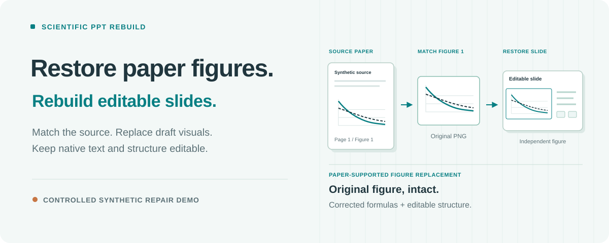
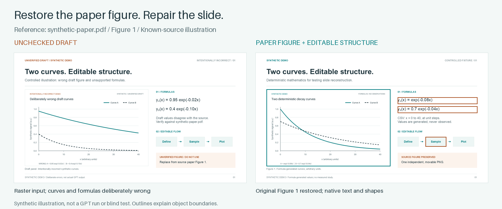
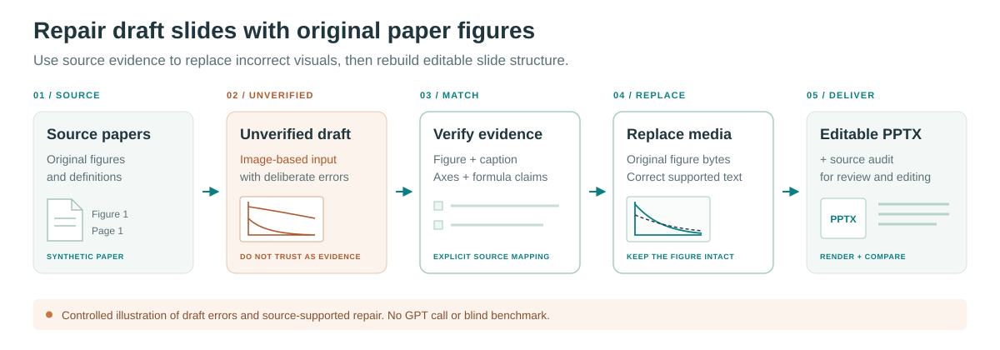

# Scientific PPT Rebuild

**用论文原图修复 AI 生成的科研幻灯片。**

[English](README.md) · [使用指南](docs/usage.md) · [隐私与分享](docs/privacy.md) · [依赖说明](docs/dependencies.md) · [参与贡献](CONTRIBUTING.md)



图片版幻灯片可能排版精美，却画错曲线、写错公式，或出现论文不支持的标注。把幻灯片草稿和对应论文 DOCX/PDF 一起交给 Codex：这个技能核对论文与幻灯片的对应关系，用实际论文图像替换已确认的科研图，修正有来源支持的标签与标注，再重建可编辑的 PowerPoint 版式。

```text
论文 → AI/图片版幻灯片草稿 → 对照论文修复 → 可编辑、可追溯的成品
```

本技能负责修复与重建环节。通用图片转可编辑流程解决对象编辑问题；这里增加的是**论文—Figure—子图的对应核验、论文原图替换、完整 Figure 保留，以及来源、修正、哈希和裁剪记录**。选定可靠来源后，科研图片本身保持原样。

版本 **0.1.0** · 以文件夹形式安装的 Codex 技能 · 最终验收使用 **Windows 桌面版 PowerPoint**

## 安装

直接对 Codex 说：

```text
请安装以下 GitHub 目录中的 Codex 技能：
https://github.com/fwbeiliya66/scientific-ppt-rebuild/tree/main/skills/scientific-ppt-rebuild
```

也可以下载或克隆仓库，在仓库根目录用 Python 3.11+ 运行：

```sh
python install.py --install-deps
```

安装器使用本机 `.codex/skills` 目录结构，并在安装后的技能目录内创建独立的 `.venv`。如果已有合适的 Python 环境，可以省略 `--install-deps`。Windows 用户也可以运行 [`Install.ps1`](Install.ps1)，它会检测 Python，默认安装依赖。

已有安装默认受到保护。依赖安装失败时，已复制的技能核心和先前备份均会保留，并打印修复命令。恢复方法、自定义位置和显式替换见[安装指南](docs/usage.md#installation)。如果 Codex 尚未发现新技能，可重新打开应用。

## 对照论文修复草稿

同时附上幻灯片草稿和对应论文，输入：

```text
使用 $scientific-ppt-rebuild 对照所附论文修复这些幻灯片草稿。
逐项核对结论、实验、Figure、图注、子图、坐标轴和单位。
确认对应关系后，用实际论文图像替换科研图；保留完整 Figure，子图使用原生图片裁剪。
只有论文支持时才修正幻灯片标签、公式、单位和额外标注，并记录每项修正。
周围文字和版式结构使用 PowerPoint 原生对象重建。
无法匹配的草稿区域保留并标记为“未核验”，报告疑似虚构内容。
交付新的 PPTX、来源与修正审计、实际使用的 Figure，以及 PowerPoint 验收情况。
```

匹配需要查看实际图像、图注和实验语境；外观相似或图注位置接近都不足以确认对应关系。没有可靠原始来源时，保留草稿区域并明确标记为**未核验**，不能把它计作已验证证据。哈希只能证明字节一致，不能为 AI 虚构结果背书。

这是一个需要智能体逐页检查、修复和复核的工作流。**多页任务需要真实、独立的页面工作智能体**。它不是单条命令完成的转换器，也不保证自动匹配或完整事实核验。

## 哪些内容可以编辑？

| 内容 | 输出形式 | 可编辑范围 |
| --- | --- | --- |
| 标题、正文、有来源支持的幻灯片标签与数字 | 原生文本框和文本片段 | 内容、字体、字号、颜色、位置 |
| 色块、边框、箭头、连接线、额外标注 | 原生形状和线条 | 几何、填充、轮廓、位置 |
| 公式 | 原生文字、上下标及所需形状 | 符号和排版组成；复杂公式需要逐项复核 |
| 已核对的论文曲线、热图、显微图、结果子图 | 独立且未改动的论文来源图片，保留内部坐标轴和图例 | 移动、等比缩放、原生裁剪 |
| 未匹配的草稿科研图 | 独立保留的图片，明确标记为未核验 | 移动、等比缩放、原生裁剪 |
| 复杂插图和标志 | 独立的语义图片 | 移动、等比缩放、裁剪 |

数据点、坐标轴、比例尺和统计标记仍在来源图片内部，不会全部拆成可编辑图形。工作流用有依据的论文图像替换不可靠草稿图，不重画实验数据。图周围的幻灯片文字和结构单独重建为原生对象。

## 查看合成示例



比较故意含错的[草稿 PPT](examples/synthetic-signal/draft-demo.pptx)、[草稿科研图](examples/synthetic-signal/draft-figure.png)与[修复后的可编辑 PPT](examples/synthetic-signal/editable-demo.pptx)。本示例以[合成论文](examples/synthetic-signal/synthetic-paper.pdf)中的 Figure 1 为依据，来源图像为 [source-figure.png](examples/synthetic-signal/source-figure.png)。修复版嵌入完全相同的来源图片字节，并用原生文本修正公式；[figure-mapping.csv](examples/synthetic-signal/figure-mapping.csv)记录替换与有依据的公式修正。

前后科学内容的差异是有意设计的。所有内容均为全新生成的合成数学；草稿错误由程序构造，用于说明拟议的“GPT/图片版幻灯片 → 对照论文修复”流程。**本示例没有调用 GPT 生成草稿**，也不是重建或事实核验的盲测基准。再生成方法、实际检查和边界见[示例说明](examples/synthetic-signal/README.md)与[验证记录](docs/verification.md)。

## 流程与交付



智能体先建立输入快照，再将幻灯片结果映射到所提供的论文，记录有依据的修正，逐页重建。科学内容对照论文复核，周围版式对照草稿复核；最后在 PowerPoint 中渲染，并在临时副本中测试代表性编辑操作。自动检查提供审计证据，不能独立证明科学正确性。

验收通过后交付：

- 新输出位置中的可编辑 `.pptx`。
- `image_sources.csv`：追溯论文、Figure、子图、来源状态、哈希和裁剪信息。
- `used_figures/`：保留实际使用的完整来源图，即使页面只裁剪显示其中一个子图。
- 修正与例外说明、未解决的证据状态，以及 PowerPoint 实际验证情况。

运行目录还会保留输入快照、逐页清单、构建清单、预览和审计记录，用于续跑与复核。这些文件可能含有私密内容和本机路径，分享前请阅读[隐私说明](docs/privacy.md)。

## 没有论文时

仅幻灯片保留是次要模式：输入 PPT/PPTX、幻灯片 PDF 或有顺序的截图，重建可编辑结构，科研图作为未改动的独立图片保留。这只能保留幻灯片已有内容，不能证明图像出自论文或相关结论正确。未核验或疑似虚构的内容必须继续明确标识。详情见[两种输入模式](docs/usage.md#choose-your-inputs)。

## 环境与边界

- **Python 3.11+** 和 [`requirements.txt`](skills/scientific-ppt-rebuild/requirements.txt) 中的依赖；可选依赖安装使用独立环境。
- **具备看图和本地工具能力的智能体**；多页任务还需要真实的页面工作智能体，脚本本身不会提供这些能力。
- **Windows 桌面版 PowerPoint** 用于最终渲染与可编辑性检查。可用时，LibreOffice 可以支持初步渲染；缺少规定的 PowerPoint 检查时，必须明确说明，不能声称已完成本工作流的完整验收。
- **可辨认的来源和合适字体**。遮挡文字、低清晰度、不同论文版本可能需要澄清或干净原图。匹配和核验仅覆盖提供的证据与实际复核范围，不保证完整事实正确性或像素级完全一致。

本地提取和构建不意味着在线智能体或可选 OCR、图像服务也在本地运行。选择处理环境前，请查看[依赖](docs/dependencies.md)与[隐私说明](docs/privacy.md)。

## 文档与致谢

详细操作见[使用指南](docs/usage.md)。执行约定见 [`SKILL.md`](skills/scientific-ppt-rebuild/SKILL.md)，另有[科研图匹配](skills/scientific-ppt-rebuild/references/figure-matching.md)与[验收检查](skills/scientific-ppt-rebuild/references/verification.md)说明。

随附运行时改编自 [ningzimu/image-to-editable-ppt-skill](https://github.com/ningzimu/image-to-editable-ppt-skill)。原 MIT 版权声明保留于 [runtime/LICENSE](skills/scientific-ppt-rebuild/runtime/LICENSE)，改编说明见 [runtime/NOTICE](skills/scientific-ppt-rebuild/runtime/NOTICE)。

本仓库自有的可复用代码和文档采用 [MIT 许可](LICENSE)。Python 依赖各自保留原许可，其中 **PyMuPDF 采用 AGPLv3 或 Artifex 商业许可**；详情见[依赖许可表](docs/dependencies.md#licenses)。
